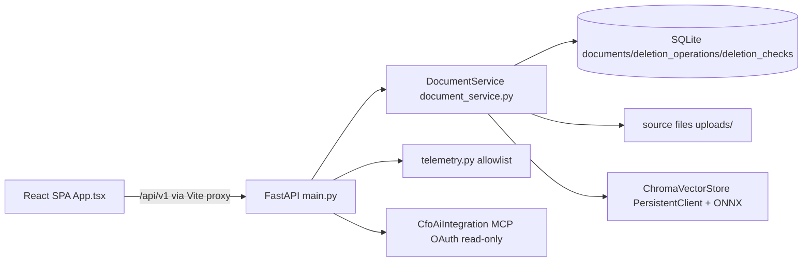
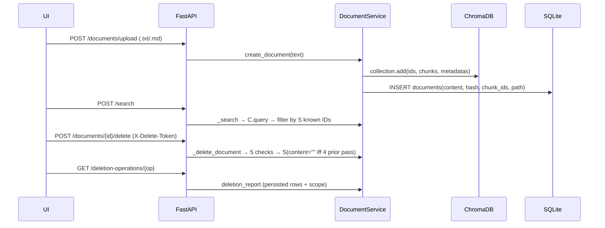

# GhostErase — Read-Only Application Audit (2026-10-10)

Scope: facts only. No application code, dependency, configuration, database, or frontend changes were made in this phase. Working tree was clean at start and was not modified except by creating this new audit file (no existing doc overwritten).

- Branch: `samarthkarnam4246-ghost-erase-phase-2` tracking `origin/samarthkarnam4246-ghost-erase-phase-2`
- `git status --short --branch`: clean (only branch header, no modified/untracked entries shown)
- Recent commits: `25d837f Add Neatlogs tracing and acceptance docs`, `5536926 Build GhostErase MVP foundations and test suite`
- `git stash list`: empty. `git diff --check`: pass. Remote: `https://github.com/SamarthKarnam4246/GhostErase.git`
- `.env`: absent on this machine; `git check-ignore -v .env` → `.gitignore:1:.env`. Secret values never displayed.
- `backend/data/`: absent. `frontend/node_modules/`: absent. No `Dockerfile*`, no `.github/`.
- Stack checkpoint: Python/FastAPI + SQLite + ChromaDB + local ONNX + React/TS **is actually present** in code. Plan follows the code; no adjustment needed.

## 1. Executive summary

GhostErase is a local-first RAG deletion-orchestration MVP, not a production secure-erasure product. The implemented core — `.txt`/`.md` upload validation, deterministic chunking, real ChromaDB `PersistentClient` with `DefaultEmbeddingFunction` (`all-MiniLM-L6-v2` ONNX), SQLAlchemy metadata, five persisted deletion checks with honest API-level scoping, `DELETE_AUTH_TOKEN` gating, and a React dashboard — is coherent and truthful about its limits (`physical_erasure_verified: false`, explicit `not_examined` list).

What really works (in code; runtime not re-observed here): input validation, document-scoped chunk IDs, exact-set Chroma delete guard, failure-preserving orchestration (SQL content retained unless 4 prior checks pass), report assembly from persisted rows, loopback/origin guards, telemetry redaction boundary, CFO read-only allowlist.

Top risks: (a) test/build/E2E **could not be rerun** here — project deps missing (`fastapi`, `sqlalchemy`, `chromadb`, `dotenv`) and `frontend/node_modules` absent, so README's historical 39+1 pass claims are unverified current evidence; (b) no persistent cache/conversation-memory/backup connectors exist, so the signature stale-cache demo has nothing to detect yet; (c) `POST /verify` is report retrieval, not re-verification; its frontend wrapper is dead code; (d) `requirements.txt` vs `backend/pyproject.toml` diverge (`alembic` vs `numpy/pytest/httpx/litellm`, `httpx` vs `httpx2`); (e) DB migration is import-time `create_all` + inline `ALTER TABLE`, not versioned Alembic.

## 2. Observed architecture

Processes: Uvicorn FastAPI backend (loopback `127.0.0.1`, `backend/app/main.py:34,39-40`), Vite React SPA calling `/api/*` through proxy (`frontend/vite.config.ts`, `frontend/src/api/client.ts:12`). Data stores: SQLite (`backend/app/db/session.py:9-12`, default `backend/data/ghosterase.sqlite3` via `backend/app/core/config.py:17`), source files (`backend/data/uploads`), ChromaDB (`backend/data/chroma`, collection `ghosterase_documents`). Embeddings: `ChromaVectorStore.__init__` (`backend/app/services/vector_store.py:16-24`) uses `chromadb.PersistentClient` + `DefaultEmbeddingFunction()`. Frontend state: React `useState` screens `overview|documents|reports|integrations` (`frontend/src/App.tsx:27`), in-memory token only.

## 3. Real request flows

Upload: `POST /api/v1/documents/upload` (`main.py:243-265`) validates suffix+content-type allowlist (`main.py:248`), 5 MiB cap (`251-253`), strict UTF-8 (`254-257`), non-empty (`258-259`) → `DocumentService.create_document` → `_create_document` (`document_service.py:51-129`): `_safe_filename` (`42-49`), UUID dir, `os.open(O_CREAT|O_EXCL, 0o600)` (`75`), `vector_store.add_document` (`78`), SQLAlchemy `DocumentRecord` with `content`, SHA-256 `content_hash`, `chunk_ids` JSON, `source_file_path`, `status=indexed` (`79-92`). Failure cleans vector + file (`93-112`).

Chunk/embed: `ChromaVectorStore.chunk_text` (`vector_store.py:27-44`, 1000/120, word boundary, deterministic) → `_chunk_id` = `uuid5(document_id, index:sha256(chunk))` (`47-49`) → `collection.add(ids, documents, metadatas{document_id, chunk_index, source, filename})` (`62-74`).

Search: `POST /api/v1/search` (`main.py:291-298`, `SearchPayload` limit 1–20 at `main.py:106-108`) → `DocumentService._search` (`221-238`): `vector_store.query` (bounded 1–20 at `vector_store.py:118-119`) then filter to `(document_id, chunk_id)` in SQL records with `status != deleted`. Hiding deleted docs at app layer is not deletion proof.

Delete: `POST /documents/{id}/delete` with `X-Delete-Token` (`main.py:268-273`) → `delete_document` → `_delete_document` (`document_service.py:293-552`): auth gate → persisted `DeletionOperation(running)` → 5 checks → `pass` iff all 5 pass → `deletion_report`.

Verify/report: `POST /documents/{id}/verify` (`main.py:276-278`) → `verify_document` (`631-650`) returns latest persisted report or `not_verified`; **no fresh backend checks**. `GET /deletion-operations/{id}` (`301-306`) → `deletion_report` (`554-629`) assembles operation + ordered checks + `scope{api_level_accessibility_only:true, physical_erasure_verified:false, not_examined:[SSD remanence, filesystem journals, backups, storage outside configured layers]}`.

## 4. Capability matrix

| Feature | Label | Location / evidence |
|---|---|---|
| `.txt`/`.md` validation (type, UTF-8, 5 MiB, empty) | IMPLEMENTED BUT NOT TESTED (this env) | `main.py:244-259`; tests exist but not rerun |
| Deterministic chunking + IDs, parent lineage | IMPLEMENTED BUT NOT TESTED | `vector_store.py:27-49` |
| Local ONNX embed + PersistentClient index/search | IMPLEMENTED BUT NOT TESTED | `vector_store.py:16-24,51-76,118-148` |
| Source-file handling + traversal guard | IMPLEMENTED BUT NOT TESTED | `document_service.py:42-49,344-356` |
| Tracked Chroma delete + residual + retrieval + SQL-clear orchestration | IMPLEMENTED BUT NOT TESTED | `document_service.py:339-541` |
| Persisted per-check reports, honest scope | IMPLEMENTED BUT NOT TESTED | `document_service.py:554-629`; UI `App.tsx:368-392` |
| `DELETE_AUTH_TOKEN` via `X-Delete-Token`, fail-closed | IMPLEMENTED BUT NOT TESTED | `document_service.py:293-302`, `config.py:20`, `client.ts:84-88` |
| Dashboard aggregates from persisted rows | IMPLEMENTED BUT NOT TESTED | `document_service.py:161-208`, `App.tsx:253-292` |
| Telemetry redaction boundary | IMPLEMENTED BUT NOT TESTED | `telemetry.py:18-60,178-219` |
| CFO read-only allowlist + vault fail-closed | IMPLEMENTED BUT NOT TESTED | `cfo_ai.py` (~798 lines), `main.py:202-240` |
| Cross-provider lifecycle registry (cache/memory/logs/exports/backups) | MISSING | grep: only `not_examined` mentions, no registry/cache tables |
| Persistent cache layer + stale-cache demo | MISSING | no `cache_entries`/cache service in code |
| AI investigation agent | MISSING | no agent code; Neatlogs/CFO do not decide status (correct) |
| Verify re-execution | MISSING (report-only today) | `document_service.py:631-650`; `client.ts:91-93` wrapper dead (not imported in `App.tsx:3-16`) |
| Full SQL nullification | PARTIAL (content cleared only) | `document_service.py:498-507` retains filename/hash/chunk_ids/path |
| Retrieval probe breadth | PARTIAL (first 1000 chars only) | `document_service.py:459` |
| Legacy `src/ghosterase` vector path | BROKEN by design (disabled `BLOCKED`) | `src/ghosterase/service.py:22-31`, `vectorstore.py:14-18`; `tests/test_ghosterase.py` asserts BLOCKED |
| Rerun of 39 pytest + 1 E2E + build/lint | UNVERIFIED here | historical `docs/ACCEPTANCE.md`; this env lacks deps/node_modules (see §8) |
| Hosted embeddings, Neatlogs app trace, CFO live auth, Entire capture | BLOCKED / UNVERIFIED | `README:24-25,29-30`, `ACCEPTANCE.md:5,32-60` |

## 5. Five-layer deletion check audit

All in `document_service.py`. Outcomes recorded via `_record_check` (`240-273`) with timestamp/method/result/identifiers/sanitized `_safe_error` (`275-277`, no content/credentials).

1. `source_file` / `path.unlink_and_path.exists` (`404-412`; logic `341-403`): unlinks expected `upload_dir/document_id/safe_filename`, rejects symlinks/mismatch (`350-355`), records `file_exists_before/after_delete` + path SHA-256 fingerprint (`356-357`, hash of path string, not content). Retry accepts prior `pass` for same fingerprint (`358-383`). Observes only this API path's absence. Cannot prove journal/SSD/backup erasure. False-success risk low but nonzero if file recreated at same UUID path (unlikely); fingerprint is identity, not content proof. Errors → `fail` with sanitized detail.
2. `chromadb_api` delete / `collection.get(ids, where=document_id) then collection.delete(ids, where=document_id)` (`423-431`; `vector_store.delete_chunks` at `vector_store.py:95-116`): requires exact set match (`111-113`, prevents cross-doc delete), returns `api_response_received:true`. Acknowledgement only; independent proof deferred to check 3. Errors → `fail`.
3. `chromadb_api` residual / `collection.get(where=document_id)` (`444-452`; `vector_store.document_chunks` at `vector_store.py:78-93`): `pass` iff zero residual IDs, records `residual_chunk_ids/residual_count`. Observes only this collection via this filter. Cannot prove HNSW remanence/replicas/other collections. Residuals → `fail` (correct, no false success). Query errors → `blocked`.
4. `application_retrieval` / normal Chroma query with in-memory pre-deletion query (`473-481`; query at `457-470`): queries `original_content[:1000]`, `pass` iff no hits map to target doc; records `matching_chunk_ids/returned_document_ids/result_count`. Observes only this query path. **Coverage gap:** tail chunks of large docs may not match first-1000-char probe (residual check covers it, but probe alone is weak). Empty content → `blocked` with reason (`471-472`). Query errors → `blocked`.
5. `sql_metadata` / clear-then-reread (`514-522`; gate at `490`): runs clear only if prior 4 are all `pass`; sets `content=""`, `deleted_at`, re-reads to confirm empty. Preserves content on any failure (recovery-correct). **Not nullification:** retains `filename/content_hash/chunk_ids/source_file_path/status`. Cannot prove SQLite freelist/WAL/backup erasure. Final rollup (`524-541`): 5×`pass` → `pass`/`deleted`; any `fail` → `fail`/`deletion_failed`; else `blocked`/`deletion_blocked`. No LLM/content influence on status.

## 6. Persistence and restart behavior

Persistent (code-verified, not observed here since `backend/data/` absent): SQLite file (`db/session.py:9-12`, `config.py:17`), source files (`config.py:18`), Chroma dir (`config.py:21`, `vector_store.py:16-19`), OS vault for CFO tokens (never frontend). `Base.metadata.create_all` + 4 additive `ALTER TABLE` upgrades run at import (`session.py:17-28`); no Alembic revisions despite `alembic==1.14.1` in `pyproject.toml` (`ARCHITECTURE.md:69-71` acknowledges). In-memory only: frontend `deleteToken/query/results` (`App.tsx:36-38`), `DocumentService` wrapper state, telemetry init flags (`telemetry.py:15-17`). E2E overrides DB/upload/Chroma to temp dirs and cleans up (`ghost-erase.spec.ts:49-60`); unit `app_environment` fixture uses `tmp_path` + unique collection names (`test_verification.py:66-84`). What survives restart: documents/operations/checks, source files, Chroma collections, vault entries. What does not: UI token/query state, in-memory search results, uncommitted sessions.

## 7. Security review

- Deletion auth (exact): `DELETE_AUTH_TOKEN` env (`config.py:20`, empty default) vs `X-Delete-Token` header (`main.py:269`, `client.ts:87`) with `secrets.compare_digest` (`document_service.py:294-297`); missing/mismatch → `blocked` + HTTP 403 before operation creation (`main.py:271-273`, `document_service.py:298-302`). Verified correct; fail-closed. Assumption: operator sets strong token in ignored `.env` (absent here).
- Secrets: `.env.example` placeholders only; `.gitignore` ignores `.env/*.sqlite3/data/chroma/node_modules` (`1-22`); status endpoints expose config states only (verified in `main.py:120-129`, `dashboard:142-194`; tests assert no `api_key/access_token/delete_auth_token` keys in `test_verification.py:288-297`). CFO tokens in OS vault, never frontend/logs.
- Upload validation: suffix+content-type allowlist, 5 MiB, strict UTF-8, non-empty (`main.py:244-259`); `_safe_filename` strips traversal, enforces `.txt/.md`, 180-char cap (`document_service.py:42-49`); `O_CREAT|O_EXCL` + `0o600/0o700` modes (`72-75`); document-scoped `upload_dir/id/filename` with symlink/mismatch rejection on delete (`344-355`).
- SQL safety: SQLAlchemy ORM throughout; no raw string interpolation (only controlled `ALTER TABLE ... ADD COLUMN` at startup). No destructive raw SQL routes.
- Network: loopback-only middleware (`main.py:72-79`), Origin allowlist (`81-96`), `TrustedHostMiddleware` (`35-38`), `nosniff/DENY/no-referrer/no-store` (`98-103`). Local-MVP only, not production assessment.
- Logging/errors: `_safe_error` omits content/credentials (`276-277`); upload/index/search failures sanitized (`main.py:265,298`); telemetry allowlist drops logs/events/descriptions (`telemetry.py:178-219`); document text rendered as text per README/SECURITY.
- Concrete risks: no rate limiting; upload/search/list/dashboard unauthenticated (acceptable local-only, must not expose); POSIX modes no-op on Windows (inherited ACLs per docs); import-time FS/DB side effects (`config.py:10`, `session.py:17-28`); `/verify` unauthenticated read (intentional but undocumented); `requirements.txt`↔`pyproject.toml` drift risks wrong-env installs.

## 8. Tests

Documented commands (`README:68-75`): `PYTHONPATH=. python -m pytest -q`; `cd frontend && npm run build && npm run lint && npx playwright install chromium && npm run test:e2e`.

Actual results this phase (no code changes, no installs):
- `/opt/homebrew/bin/python3.14 -m pytest --collect-only -q` → 5 collection errors, 0 collected: `No module named 'dotenv'/'fastapi'/'sqlalchemy'/'neatlogs'`; `pip show fastapi sqlalchemy chromadb` → not found. System `python3` is 3.9.6 (below `requires-python >=3.12`). No `.venv/`. Reason: project deps never installed in this machine's Python environments.
- Frontend: `frontend/node_modules` absent → `npm run build/lint/test:e2e` not runnable. Node v26.11.1 / npm 11.20.0 present, but install step not executed per read-only audit safety (would change environment; report first per instructions).
- `git diff --check`: pass. `git status`: clean.
- Historical claims (not current evidence): `docs/ACCEPTANCE.md` reports 39 passed + 1 E2E passed on 2026-10-10 with isolated PersistentClient Chroma/SQLite, control preservation, failure injection, restart persistence; `IMPLEMENTATION_REPORT.md` mirrors. Treat as historical until rerun after `pip install -r requirements.txt` + `npm install`.

Coverage gaps: no persistent-cache tests (no cache exists); no verify re-execution tests (verify is read-only retrieval today); retrieval probe tail coverage untested; no frontend unit tests (only Playwright); no clean-machine reproduce run; live Neatlogs/CFO/Entire/hosted-embedding gates require external auth and are correctly not mocked.

## 9. UI audit

Connected: upload (`App.tsx:65-81` → `client.ts:62-69`), search (`83-94` → `75-82`), delete+report (`96-113` → `84-89`), report open (`208-218` → `30-32`), health/docs/dashboard/CFO flows (`44-55`, `115-206`). No sample/seeded figures; counts/statuses come from persisted API data (`253-292`). No hard-coded finance values; disconnected CFO shows unavailable/insufficient (`447-451`).

Dead/misleading: `verifyDocument` (`client.ts:91-93`) never imported in `App.tsx:3-16` — no UI trigger for `POST /verify`; per-doc "View latest report" only loads existing operation (`346`), and delete button disabled when `status===deleted` (`347`), so re-verification path is undiscoverable. No cache/lifecycle/residuals/coverage view beyond raw check JSON (`374-382`). Status strings shown verbatim without plain-language distinction of blocked vs unverified vs residual.

Top 5 UX issues: (1) add Re-verify button wired to `verifyDocument`; (2) add lifecycle/coverage panel (supported vs unsupported/unverified, residuals, limitations); (3) clarify blocked/unverified/failed states in plain language; (4) surface `X-Delete-Token` blocked guidance inline (currently message-only at `97-99`); (5) accessibility/responsiveness pass (labels exist, but no focus/error-role audit, no mobile layout check performed here).

## 10. Prioritized remediation plan

P0 (integrity/blockers): create venv (Python ≥3.12), `pip install -r requirements.txt`, reconcile `requirements.txt`↔`pyproject.toml` (`alembic`, `httpx`/`httpx2`, `numpy/pytest/litellm`), `pip check`, rerun pytest/build/lint/E2E and record actuals; do not proceed on historical claims.
P1 (deletion correctness): implement SQLite persistent cache + generic lifecycle registry (IDs/hashes only); add cache check to orchestrator with partial-failure + safe retry; broaden retrieval probe beyond first 1000 chars; clarify SQL "content cleared, identifiers retained"; make `/verify` re-execute read-only checks (persist new verification op) and wire dead `verifyDocument` to UI.
P2 (lifecycle gaps): explicit unsupported/unverified registry (backups, replicas, retention, conversation memory, logs, exports); adapter interfaces; never simulate success.
P3 (UI/quality): coverage/residuals view, plain-language states, token guidance, a11y/responsive pass; isolate/remove legacy `src/ghosterase` dead path only after P0 green; document Alembic decision.

Small phases with stop-and-report boundaries; smallest coherent diffs; no mocks for real components.

## 11. Open questions / limitations

Verified facts: everything above cites files/symbols/lines actually read; missing-cache/agent/registry conclusions come from grep + doc cross-check, not filename guessing. Assumptions (not verified here): Chroma ONNX first-run download behavior; Windows ACL/Credential-Manager paths (this machine is macOS, no `.env`/data to observe); live CFO/Neatlogs/Entire/hosted-embedding outcomes (require external auth; correctly unclaimed). Safest next phase: P0 environment setup + test rerun only (venv, `pip install -r requirements.txt` with drift note, `npm install`, pytest/build/lint/E2E), then report actuals before any app change.
